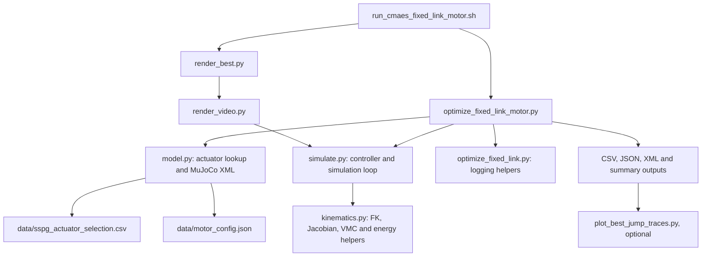

# Fixed-link, fixed-motor monoped optimization

This document explains [`optimize_fixed_link_motor.py`](optimize_fixed_link_motor.py), every file on its optimization and simulation path, how to execute the study, and how the implementation maps to the accompanying paper:

> A. Singh, A. Mishra, D. Kapa, S. Joshi, and S. Kolathaya, “A Co-Design Framework for Energy-Aware Monoped Jumping with Detailed Actuator Modeling,” arXiv:2510.05923v1, 2025. See [`2510.05923v1.pdf`](../2510.05923v1.pdf).

The program is a focused variant of the paper's Stage-2 co-design experiment. It fixes both links to 0.20 m and both motors to `MAD_M6C12`, then uses CMA-ES to optimize the initial pose, payload, two requested gear ratios, and three virtual-model-control gains.

This is not an exact reproduction of every paper setting. The [paper mapping](#mapping-to-the-paper) and [important differences](#important-differences-from-the-paper) sections distinguish direct implementations from local adaptations.

## Contents

- [System overview](#system-overview)
- [Files and execution flow](#files-and-execution-flow)
- [How to execute](#how-to-execute)
- [Optimization variables and constants](#optimization-variables-and-constants)
- [Controller and torque calculation](#controller-and-torque-calculation)
- [Simulation, actuation, and energy](#simulation-actuation-and-energy)
- [Objective and feasibility](#objective-and-feasibility)
- [Function-by-function reference](#function-by-function-reference)
- [Output files](#output-files)
- [Mapping to the paper](#mapping-to-the-paper)
- [Important differences from the paper](#important-differences-from-the-paper)
- [Troubleshooting and modification notes](#troubleshooting-and-modification-notes)

## System overview

The simulated mechanism is a planar serial 2R leg attached to a carriage that can translate only vertically:

- `q1` is the hip angle about MuJoCo's positive y-axis.
- `q2` is the knee angle relative to the thigh, also about positive y.
- The thigh and shank are each fixed at 0.20 m.
- Hip and knee torques are independently actuated.
- Both motor/gearbox masses are mounted on the carriage near the hip. The knee is driven remotely by an ideal massless transmission.
- A `pole_slide` joint restricts the carriage to world-z translation. The visible pole is non-colliding and does not itself constrain the carriage.
- The spherical foot contacts a horizontal ground plane.

The experiment therefore studies vertical jump actuation and energy. It does not study free-body balance, body pitch, or horizontal base motion.

## Files and execution flow



### Core runtime files

| File | Responsibility |
|---|---|
| `optimize_fixed_link_motor.py` | Defines the fixed-hardware search space, paper-inspired objective, CMA-ES loop, and persistent results. |
| `model.py` | Defines `Actuator` and `Design`, looks up actuator mass/efficiency, calculates motor torque, and generates MuJoCo XML. |
| `simulate.py` | Runs a candidate, selects contact/flight control, applies saturated torques, detects takeoff, accumulates energy, and checks feasibility. |
| `kinematics.py` | Implements two-link forward kinematics, Jacobian, virtual-leg state, VMC torque mapping, geometry distances, saturation, and positive work. |
| `optimize_fixed_link.py` | Supplies shared bounds, output headers, record formatting, Git metadata, and the human-readable summary. Its own optimizer is not executed by this study. |
| `data/sspg_actuator_selection.csv` | Precomputed SSPG gear-ratio lookup used as a Stage-1-like actuator map. |
| `data/motor_config.json` | Motor constants used to calculate continuous motor torque. |

### Launch, rendering, and analysis files

| File | Responsibility |
|---|---|
| `run_cmaes_fixed_link_motor.sh` | Checks dependencies, launches optimization, then renders the best candidate from three views. |
| `run_cmaes_fixed_link_motor_single_jump.sh` | Calls the main launcher with `--single-jump`. |
| `render_best.py` | Reads `best_design.json`, invokes the renderer for three camera views, and makes a horizontal collage. |
| `render_video.py` | Reconstructs a `Design`, reruns `run_jump`, and captures MuJoCo frames to MP4. |
| `plot_best_jump_traces.py` | Replays a saved best result and writes per-step telemetry as CSV and PNG. |
| `tests/test_fixed_link_motor.py` | Checks fixed hardware selection and the objective formula. |

## How to execute

Run all commands from the repository root.

### 1. Create or activate a Python environment

Python 3.10 or newer is recommended. The launcher automatically activates `.venv` if that directory exists.

```bash
python -m venv .venv
source .venv/bin/activate
python -m pip install --upgrade pip
python -m pip install numpy pandas mujoco cma imageio imageio-ffmpeg matplotlib
```

The optimization itself needs `numpy`, `pandas`, `mujoco`, and `cma`. Rendering additionally needs `imageio` and an ffmpeg backend. Telemetry plotting needs `matplotlib`.

For a headless NVIDIA/Linux system, use EGL:

```bash
export MUJOCO_GL=egl
```

### 2. Run the regression tests

```bash
python -m unittest discover \
  -s single_axis_2bar_codesign/tests \
  -p 'test_*.py'
```

These tests are configuration checks, not a complete numerical validation of the controller or MuJoCo trajectory.

### 3. Run a short smoke test

This directly invokes the optimizer, evaluates four candidates, and avoids the launcher's automatic rendering step:

```bash
python single_axis_2bar_codesign/optimize_fixed_link_motor.py \
  --maxiter 1 \
  --popsize 4 \
  --seed 5 \
  --simulation-duration 0.5 \
  --single-jump \
  --output-dir single_axis_2bar_codesign/results/smoke_test
```

Inspect:

```bash
cat single_axis_2bar_codesign/results/smoke_test/summary.txt
head single_axis_2bar_codesign/results/smoke_test/all_candidates.csv
```

A very short smoke test may find no valid takeoff. Its purpose is to validate imports, XML generation, simulation, and result writing.

### 4. Run the complete launcher workflow

```bash
bash single_axis_2bar_codesign/run_cmaes_fixed_link_motor.sh
```

The current launcher defaults are:

- random seed: `5`
- CMA-ES generations: `1000`
- population: `8`
- simulation duration: `2.0 s`
- mode: multi-jump/contact-reactivating controller
- rendering backend: `egl`

Override the study size without editing the script:

```bash
bash single_axis_2bar_codesign/run_cmaes_fixed_link_motor.sh \
  --seed 7 \
  --maxiter 100 \
  --popsize 12 \
  --simulation-duration 2.0
```

The launcher creates a timestamped directory under `single_axis_2bar_codesign/results/`, saves the optimization log, and attempts to create three MP4 views plus a collage.

### 5. Run exactly one powered jump

```bash
bash single_axis_2bar_codesign/run_cmaes_fixed_link_motor_single_jump.sh \
  --maxiter 100 \
  --popsize 8 \
  --simulation-duration 2.0
```

In this mode, contact VMC drives the initial stance, joint PD acts in flight, and actuation is permanently disabled after the first post-takeoff touchdown. Use this mode when the objective should not benefit from later powered hops.

The equivalent direct invocation is:

```bash
python single_axis_2bar_codesign/optimize_fixed_link_motor.py \
  --maxiter 100 \
  --popsize 8 \
  --seed 5 \
  --simulation-duration 2.0 \
  --single-jump
```

### 6. Replay and plot the best candidate

Set `RUN_DIR` to a completed output directory:

```bash
RUN_DIR=single_axis_2bar_codesign/results/fixed_link_MAD_M6C12_single_jump_run_YYYY-MM-DD_HH-MM-SS_seed5

python single_axis_2bar_codesign/plot_best_jump_traces.py "$RUN_DIR"
```

This produces:

- `best_jump_telemetry.csv`
- `best_jump_telemetry.png`

The replay reads the saved controller mode and candidate values. It is useful for inspection, but the controller logic is duplicated in the replay utility, so keep it synchronized with `simulate.py` if the controller changes.

### 7. Render an existing best design manually

Normally the launcher does this automatically. To rerun it:

```bash
python single_axis_2bar_codesign/render_best.py \
  --best-json "$RUN_DIR/best_design.json" \
  --renderer single_axis_2bar_codesign/render_video.py \
  --output-dir "$RUN_DIR" \
  --duration 2.0 \
  --single-jump
```

Omit `--single-jump` for a result optimized with `authors_contact_vmc`.

## Optimization variables and constants

### Eight-dimensional CMA-ES vector

The optimizer searches in a normalized unit cube. `denormalize()` maps each component into the following physical interval:

| Index | Name | Bounds | Units | Meaning |
|---:|---|---:|---|---|
| 0 | `theta1` | `[-pi/2, pi/2]` | rad | Initial hip angle. |
| 1 | `theta2` | `[0.03, pi-0.03]` | rad | Initial relative knee angle, kept away from exact folded/straight singular limits. |
| 2 | `payload_mass` | `[0.25, 3.0]` | kg | Payload carried by the carriage. |
| 3 | `hip_gear_ratio` | `[4, 25]` | dimensionless | Requested hip reduction ratio. |
| 4 | `knee_gear_ratio` | `[4, 25]` | dimensionless | Requested knee reduction ratio. |
| 5 | `K` | `[0, 200]` | N/m | Virtual radial spring stiffness. |
| 6 | `C` | `[0, 10]` | N s/m | Virtual radial damping. |
| 7 | `T_gain` | `[0, 20]` | N m/rad | Virtual-leg orientation stiffness. |

The initial physical mean is:

```text
[-0.70, 1.40, 1.0, 10, 10, 100, 5, 10]
```

CMA-ES starts with normalized standard deviation `sigma = 0.06`, population 8 unless overridden, bounded samples in `[0,1]^8`, and `tolflatfitness = maxiter + 1` so an initially flat infeasibility population does not end the study immediately.

### Fixed values

| Constant | Value | Effect |
|---|---:|---|
| `FIXED_L1_M` | `0.20 m` | Fixed thigh length. |
| `FIXED_L2_M` | `0.20 m` | Fixed shank length. |
| `FIXED_HIP_MOTOR` | `MAD_M6C12` | Motor family at the hip. |
| `FIXED_KNEE_MOTOR` | `MAD_M6C12` | Motor family at the knee. |
| `AUTHOR_REST_LENGTH_M` | `10.0 m` | Virtual spring rest length. This is intentionally unreachable for a 0.40 m leg and creates a strong extension command. |
| `AUTHOR_ORIENTATION_RAD` | `0 rad` | Desired virtual leg direction: vertically downward. |
| `AUTHOR_HEIGHT_WEIGHT` | `0.65` | Height-cost weight. |
| `AUTHOR_ENERGY_WEIGHT` | `0.35` | Energy-cost weight. |
| `AUTHOR_HEIGHT_OFFSET_M` | `0.5 m` | Added inside the height exponent. |
| `AUTHOR_SIMULATION_DURATION_S` | `8.0 s` | Default direct-run duration and stored `thrust_time`. In the contact modes used here, `thrust_time` does not gate the VMC. |

### Candidate construction

`design_from_vector()` performs these operations:

1. Validate and denormalize the CMA-ES vector.
2. Fix both links to 0.20 m.
3. Fix both motor names to `MAD_M6C12`.
4. Call `actuator_for()` separately for the requested hip and knee ratios.
5. Fix virtual rest length and orientation to 10 m and 0 rad.
6. copy optimized `K`, `C`, and `T_gain` into a frozen `Design` record.
7. Set `thrust_time` to 8 s.

## Controller and torque calculation

### Coordinate convention

The foot position relative to the hip is

```text
p = [px, pz]
```

with

```text
px = -l1 sin(q1) - l2 sin(q1 + q2)
pz = -l1 cos(q1) - l2 cos(q1 + q2)
```

The virtual-leg length and angle are

```text
L     = ||p||
theta = atan2(px, -pz)
```

Thus `theta = 0` means the foot is vertically below the hip. The controller does not require `px = 0`.

The analytical foot Jacobian is

```text
J = d[px, pz] / d[q1, q2]

  = [[-l1 cos(q1) - l2 cos(q1+q2), -l2 cos(q1+q2)],
     [ l1 sin(q1) + l2 sin(q1+q2),  l2 sin(q1+q2)]]
```

so foot velocity is `pdot = J qdot`.

### Virtual radial spring-damper

`virtual_leg_state()` computes radial extension speed as

```text
Ldot = er^T J qdot
er   = p / L
```

The controller then computes

```text
Fr = K (L0 - L) - C Ldot
```

where `L0 = ori_l`. Positive `Fr` points from hip to foot and commands extension. This matches the structure of paper Equation (1).

Because this study sets `L0 = 10 m` while the physical maximum is `l1 + l2 = 0.40 m`, `K(L0-L)` is normally very large. The final motor limits therefore dominate for much of stance. `K` still changes how quickly and how often saturation occurs, but this is closer to a saturated-extension command than a reachable spring equilibrium.

### Virtual orientation spring

The orientation error is wrapped to the shortest angular displacement:

```text
Mtheta = T_gain * wrap_to_pi(theta0 - theta)
```

This matches the proportional torsional-spring structure of paper Equation (2). There is no orientation-rate damping term.

Define a tangential unit vector by rotating the radial vector 90 degrees:

```text
etheta = [-er_z, er_x]
```

A tangential force `Ftheta` at radius `L` produces moment `Mtheta = L Ftheta`, hence

```text
Ftheta = Mtheta / L
```

The complete virtual foot force is

```text
F = Fr * er + (Mtheta / L) * etheta
```

### Jacobian-transpose torque map

The commanded joint torque is

```text
tau_raw = J.T @ F
```

This follows virtual work:

```text
F.T dp = tau.T dq
dp     = J dq
tau    = J.T F
```

The two outputs are the raw hip and knee torque commands. They are not sent directly to MuJoCo; motor saturation and gearbox efficiency are applied first.

### Contact, flight, and touchdown state machine

`run_jump()` selects commands on every 1 ms simulation step:

| Mode/state | Command |
|---|---|
| `authors_contact_vmc`, foot in contact | Virtual-model controller described above. |
| `authors_contact_vmc`, flight | Joint-space PD back to the initial `theta1`, `theta2`. |
| `authors_single_jump`, initial stance | Same contact VMC. |
| `authors_single_jump`, flight | Same joint-space PD. |
| `authors_single_jump`, after first landing | Zero torque permanently. |

The flight controller is

```text
tau_hip  = 100 (theta1_initial - q1) - 10 qdot1
tau_knee = 100 (theta2_initial - q2) - 10 qdot2
```

These gains are fixed and are not optimized.

### Meaning of “no velocity”

The current VMC does use velocity through `-C*Ldot`, and the flight PD uses joint velocities. Its desired velocity is implicitly zero.

To remove radial velocity feedback while retaining the same position/orientation controller, enforce `C = 0`:

```python
radial_force = stiffness * (ori_l - length)
```

That controller is technically proportional, not PD. A true derivative term requires either a measured velocity or a velocity estimate obtained by differentiating successive positions. Removing all velocity use also requires changing or disabling the flight PD branch.

## Simulation, actuation, and energy

### MuJoCo model generation

`write_xml()` generates one complete model for each candidate. Important properties are:

- timestep: `0.001 s`
- integrator: `implicitfast`
- gravity: `-9.81 m/s^2` along z
- joint damping: `0.08`
- ground friction: `1.2 0.01 0.0001`
- body motion: one vertical slide DOF
- leg motion: two hinge DOFs
- foot: 0.025 m radius sphere
- controller inputs: two MuJoCo motor actuators

The initial carriage height is calculated so the foot sphere is tangent to the floor for the independently selected `theta1` and `theta2`. Consequently initial carriage height is not fixed across candidates.

### Actuator lookup

`actuator_for()`:

1. filters `sspg_actuator_selection.csv` to the selected motor;
2. rounds the requested ratio to one decimal place;
3. selects the row whose `target_ratio` is nearest;
4. reads gearbox mass and efficiency from that row;
5. computes continuous motor torque from `Kv` and maximum continuous current;
6. multiplies motor torque by the requested ratio.

Motor torque is calculated as

```text
Kt             = 60 / (2 pi Kv)
tau_motor_cont = Kt * I_cont
tau_output     = tau_motor_cont * requested_ratio
```

For `MAD_M6C12`, the JSON values are `Kv = 150 rpm/V` and `I_cont = 36.2 A`.

### Saturation and application

For each joint:

```text
tau_applied = efficiency * clip(tau_raw,
                                -continuous_output_torque,
                                +continuous_output_torque)
```

The generated MuJoCo actuator also has a control range of

```text
[-efficiency * continuous_output_torque,
 +efficiency * continuous_output_torque]
```

Finally:

```python
data.ctrl[hip_actuator] = applied_hip
data.ctrl[knee_actuator] = applied_knee
```

MuJoCo integrates the constrained multibody dynamics and foot contact using those joint torques.

### Contact and takeoff detection

`foot_contact_force()` searches MuJoCo contacts for the `floor`/`foot` pair and sums the magnitude of their normal contact forces. Contact is declared when this force exceeds `1e-4 N`.

Takeoff is the first transition from having observed contact to no contact. Apex tracking begins after takeoff and records the maximum carriage z-position.

### Mechanical work

At each timestep, total joint mechanical power is

```text
P = tau_hip qdot1 + tau_knee qdot2
```

Only positive total power is accumulated:

```text
positive_work += max(0, P) dt
```

Separate hip and knee work counters apply the same positive-power rule per joint. Therefore their sum can differ from `positive_work`: simultaneous positive power at one joint and negative power at the other cancel before the total positive-part operation.

### Joule-loss proxy

The simulation additionally accumulates

```text
joule_energy += 0.0955 * (tau_hip^2 + tau_knee^2) * dt
```

and defines

```text
total_energy = positive_work + joule_energy
```

The coefficient is treated as a fixed winding-loss proxy. It is not derived per motor or adjusted for gear ratio in this code.

## Objective and feasibility

### Objective

For a valid candidate:

```text
height_cost = 100 * exp(-(0.5 + apex_height))
cost        = 0.65 * height_cost + 0.35 * total_energy
```

where:

- `apex_height` is the maximum absolute carriage z-position after takeoff;
- `total_energy` is positive mechanical work plus the Joule proxy.

CMA-ES minimizes this cost. A greater apex decreases the first term; greater energy increases the second.

### Invalid candidates

A candidate receives `INFEASIBILITY_COST = 1e6` if:

- XML generation, actuator lookup, simulation, or another evaluation step raises an exception;
- no takeoff occurs;
- any simulator position, velocity, or time becomes non-finite;
- a geometric clearance is non-finite or falls to 4 mm or less.

The checked geometric clearances are:

- foot against the hip motor, proximally mounted knee motor, or carriage body;
- foot against the visible pole capsule;
- thigh or shank capsule against the pole capsule.

The pole is visually present but non-colliding, so these are explicit rejection checks rather than physical pole contacts.

The reachable-rest-length test is intentionally skipped for `authors_contact_vmc` and `authors_single_jump`; otherwise the fixed 10 m rest length would reject every 0.40 m leg.

## Function-by-function reference

### `optimize_fixed_link_motor.py`

#### `denormalize(vector)`

Converts one normalized CMA-ES sample from `[0,1]^8` to physical units using `BOUNDS`. It rejects the wrong shape, non-finite values, and values outside the unit interval. The current exception text says “length 11”; that message is stale—the required length is 8.

#### `design_from_vector(vector)`

Builds an immutable `Design` from a normalized sample. It fixes link lengths and motor names, resolves two actuator records, installs fixed virtual-leg targets, and copies the three optimized controller gains.

#### `authors_objective(result)`

Returns `(combined_cost, height_cost, total_energy)`. Only the combined cost is passed to CMA-ES; the other two values make the calculation independently inspectable and testable.

#### `main()`

Runs the complete study:

1. parses CLI options;
2. creates the result directory and metadata;
3. constructs the normalized initial mean;
4. initializes bounded CMA-ES;
5. opens three streaming CSV logs;
6. asks CMA-ES for each generation's candidates;
7. creates a `Design`, temporary XML, and simulation result for every candidate;
8. assigns the paper-inspired cost or hard infeasibility cost;
9. writes candidate, generation-best, and global-best records;
10. copies the current global-best XML out of the temporary directory;
11. calls `es.tell(samples, costs)` to update the distribution;
12. writes final JSON, CSV, text summary, and console output.

Candidate XML uses one reused temporary pathname, so the run does not retain every generated model.

### `model.py`

#### `Actuator`

Frozen dataclass containing motor name, requested ratio, gearbox type, total actuator mass, efficiency, and continuous output torque before efficiency.

#### `Design`

Frozen dataclass containing link lengths, payload, hip/knee actuator records, initial joint pose, VMC targets/gains, and thrust duration.

#### `_continuous_motor_torque(motor)`

Reads the selected motor's `Kv` and `maxContinuousCurrent` from JSON and calculates `Kt * current`. It assumes the ideal SI conversion from rpm/V to N m/A.

#### `actuator_for(motor, ratio)`

Validates the motor, loads the SSPG lookup, selects the nearest target-ratio row, validates gearbox type, and returns an `Actuator`. See the ratio-domain warning under [Known modeling limitations](#known-modeling-limitations).

#### `link_mass(length, radius=0.018, density=700)`

Approximates each link as a solid tube-equivalent cylinder using `pi r^2 length * density`. This is a local simplified model, not the paper's aluminum/plastic/chain/sprocket part-by-part mass calculation.

#### `write_xml(design, output)`

Validates positive dimensions/masses, computes initial floor-tangent height, link masses, and actuator limits, then writes the complete MuJoCo model. It parses the written XML immediately to catch malformed output before a long optimization.

### `simulate.py`

#### `JumpResult`

Frozen result dataclass for height, takeoff, work, peak metrics, clearances, failure reason, and Joule energy. `valid` tests only whether `constraint_violation` is absent. `total_energy` adds mechanical positive work and Joule loss.

#### `vmc_joint_torques(design, q1, q2, qdot1, qdot2)`

Adapter that unpacks the relevant `Design` fields and calls `kinematics.vmc_torques()`.

#### `foot_contact_force(model, data)`

Finds all floor/foot contacts, reads MuJoCo's six-component contact force, and sums normal-force magnitude.

#### `_capsule_segment(model, data, geom_name)`

Converts a MuJoCo capsule's center, orientation, and half-length into two world-frame axis endpoints plus radius.

#### `geometry_clearances(model, data)`

Computes minimum foot-to-proximal-body clearance, foot-to-pole clearance, and link-to-pole clearance from current world-frame geometry.

#### `_reach_violation(design)`

Checks whether virtual rest length lies strictly inside the two-link reachable interval, inset by 5 mm. The fixed-motor optimizer's contact modes bypass this check because `ori_l = 10 m` is deliberately unreachable.

#### `_state_violation(model, data)`

Rejects non-finite state/geometry or any checked clearance at or below the 4 mm safety margin. It returns the failure string and all three measured clearances.

#### `_invalid_result(...)`

Packages partial metrics and the failure reason into a consistent `JumpResult`, with zero apex gain and no takeoff.

#### `run_jump(xml_path, design, duration, controller_mode, after_step)`

Loads the model, initializes joint angles, checks the initial pose, executes the controller/dynamics loop, saturates actuator commands, detects takeoff/touchdown, accumulates work and Joule loss, invokes an optional rendering callback, checks geometry after every step, tracks apex, and returns `JumpResult`.

Supported controller modes are:

- `timed_vmc`: VMC until `thrust_time`, then zero torque;
- `authors_contact_vmc`: VMC in contact and joint PD in flight;
- `authors_single_jump`: the same until first landing, then zero torque.

The fixed-motor optimizer uses only the last two.

### `kinematics.py`

#### `toe_relative_position(q1, q2, l1, l2)`

Two-link forward kinematics returning foot `[x,z]` relative to the hip.

#### `two_link_jacobian(q1, q2, l1, l2)`

Analytical derivative of foot position with respect to hip and knee coordinates.

#### `wrap_to_pi(angle)`

Maps an angular error to `[-pi, pi)` so the orientation spring uses the shortest rotation.

#### `virtual_leg_state(q1, q2, qdot1, qdot2, l1, l2)`

Returns foot position, Jacobian, virtual-leg length, radial length rate, and downward-referenced orientation. It rejects zero or non-finite leg length.

#### `vmc_torques(...)`

Calculates radial spring-damper force and orientation moment, converts the moment to tangential foot force, combines the force components, and returns `J.T @ F`.

#### `point_to_segment_distance(point, start, end)`

Calculates shortest Euclidean distance from a point to a finite 3D segment, including a degenerate zero-length segment case.

#### `reachable_length_bounds(l1, l2, epsilon)`

Returns `[abs(l1-l2)+epsilon, l1+l2-epsilon]`, avoiding the exactly folded and straight singular configurations.

#### `sphere_clearance(center_a, radius_a, center_b, radius_b)`

Returns signed surface-to-surface separation between two spheres. Negative means penetration.

#### `capsule_clearance(sphere_center, sphere_radius, capsule_start, capsule_end, capsule_radius)`

Returns signed clearance from a sphere to a capsule.

#### `sphere_box_clearance(...)`

Transforms a sphere center into an oriented box's local frame and returns signed separation. A center inside the box produces negative clearance.

#### `segment_to_segment_distance(a0, a1, b0, b1)`

Computes the closest distance between two finite 3D segments, including nearly parallel segments.

#### `saturated_applied_torque(command, continuous_limit, efficiency)`

Clips raw commanded torque to the continuous geared limit and multiplies by gearbox efficiency.

#### `positive_work_increment(applied_torques, joint_velocities, timestep)`

Computes `max(0, tau dot qdot) * dt`, excluding regenerative/negative mechanical energy.

#### `thrust_is_active(simulation_time, thrust_time)`

Returns true on `[0, thrust_time)`. It is used only by `timed_vmc`, not by the fixed-motor optimizer's contact modes.

### Imported helpers from `optimize_fixed_link.py`

The fixed-motor optimizer imports constants and only these three functions:

#### `_record(...)`

Flattens a `Design`, `JumpResult`, cost, and validity information into one dictionary matching `HEADERS`. It calculates efficiency-adjusted torque limits, total actuator mass, total moving carriage mass, and degree conversions.

#### `_git_commit()`

Attempts to record `git rev-parse HEAD`; returns `None` when Git information is unavailable.

#### `_summary(record)`

Formats the best candidate as a human-readable report.

The following functions belong to the broader variable-motor optimizer and are not called by `optimize_fixed_link_motor.py`:

- `denormalize()` maps its separate 13-variable vector.
- `motor_name()` converts a relaxed CMA coordinate to a discrete motor name.
- `design_from_vector()` builds that broader study's design.
- `main()` runs that broader optimizer with a different objective and output policy.

### Rendering and telemetry functions

#### `render_best.write_collage(video_paths, output_path)`

Reads synchronized view videos, pads frames to equal dimensions, concatenates them horizontally, and writes one collage MP4.

#### `render_best.main()`

Reads the best JSON, checks validity, reconstructs renderer CLI arguments, renders three fixed views, then calls `write_collage()`.

#### `render_video.make_camera(view)`

Creates a repeatable free MuJoCo camera for front or oblique views.

#### `render_video.main()`

Parses design/render arguments, rebuilds XML, defines a frame-capture callback, reruns `run_jump()`, and streams selected frames to MP4.

#### `plot_best_jump_traces.Trace`

Frozen array container for time, joint commands/states, carriage motion, and contact state.

#### `plot_best_jump_traces.design_from_record(record)`

Reconstructs an exact `Design` from saved output fields without repeating the nearest-row actuator lookup.

#### `plot_best_jump_traces.replay(run_dir, duration)`

Reimplements the saved contact/flight state machine, simulates it, and returns step-by-step telemetry.

#### `plot_best_jump_traces.write_trace(path, trace)`

Writes telemetry arrays to CSV.

#### `plot_best_jump_traces.plot_trace(path, label, trace)`

Writes a six-panel PNG of torque, angle, base height, velocities, and contact.

#### `plot_best_jump_traces.main()`

Processes one or more run directories using saved duration unless overridden.

## Output files

| Output | Contents |
|---|---|
| `metadata.json` | Timestamp, Git commit, seed, CMA settings, hardware, controller mode, objective description, duration, and MuJoCo version. |
| `all_candidates.csv` | Every candidate, including invalid candidates and failure reasons. |
| `generation_best.csv` | Lowest-cost valid candidate in each generation that has at least one valid candidate. |
| `best_so_far.csv` | Each new valid global-best candidate, in chronological order. |
| `best_design.json` | Final best record, or `{"best_valid_candidate": null}` if none exists. |
| `best_design.csv` | Final best record in tabular form. Empty when no valid candidate exists. |
| `best_design.xml` | MuJoCo model for the final best candidate. It exists only if a valid best was found. |
| `summary.txt` | Human-readable report for the final best candidate. |
| `run.log` | Launcher console output, including optimization and rendering. |
| `best_jump_front.mp4` | Front-view replay generated by the launcher. |
| `best_jump_left_oblique.mp4` | Left-oblique replay. |
| `best_jump_right_oblique.mp4` | Right-oblique replay. |
| `best_jump_collage.mp4` | Horizontal combination of the three views. |
| `best_jump_telemetry.csv` | Optional per-step trace generated by `plot_best_jump_traces.py`. |
| `best_jump_telemetry.png` | Optional telemetry plot. |

CSV files are flushed as candidates are evaluated, so partial progress generally survives interruption. The final JSON/CSV/summary are written only after the CMA loop exits normally.

## Mapping to the paper

Page numbers below are PDF pages, not journal pagination.

| Paper section/equation | Paper concept | Implementation | Fidelity |
|---|---|---|---|
| Section II-A, pp. 2–3 | Serial 2R leg; both actuators mounted proximally; remote knee transmission | `model.write_xml()` places both actuator masses on the carriage and applies knee torque at the knee joint through an idealized remote drive. | Structural match, simplified geometry/transmission. |
| Section II-A, Fig. 2(b) and Fig. 3 | Part-based link mass versus length | `model.link_mass()` uses one cylinder-equivalent density formula. | Simplified substitute. |
| Section II-B, Fig. 4, p. 3 | Virtual linear spring-damper plus torsional orientation spring | `kinematics.virtual_leg_state()` and `vmc_torques()`. | Direct architectural match. |
| Eq. (1) | `Fl = K(l0-l) - C ldot` | `radial_force = stiffness*(ori_l-length) - damping*length_rate`. | Direct match under local sign convention. |
| Eq. (2) | `tau_t = T(alpha0-alpha)` | `orientation_moment = T_gain*wrap_to_pi(ori_theta-theta)`. | Match with angle wrapping added. |
| Eqs. (3)–(4) | Decompose axial force and torsional moment into world x/z reaction force, with gravity term in `Fz` | Code forms radial/tangential actuator foot force vectors; MuJoCo handles gravity in dynamics. | Equivalent radial/tangential idea, not a literal transcription; signs represent actuator foot force rather than the paper's stated ground reaction. |
| End of Section II-B | `tau = J(theta1,theta2)^T F` | `return jacobian.T @ force`. | Direct match. |
| Section III-A, Eq. (11), pp. 3–4 | Stage-1 actuator optimization creates minimum-mass ratio map | `sspg_actuator_selection.csv` is consumed as a precomputed map by `actuator_for()`. | Stage-1 output reused; Stage-1 optimization itself is outside this program. |
| Section III-B.1, Eq. (12), p. 4 | `Y=[l1,l2,gk,gh,K,C,T]` | Local vector is `[theta1,theta2,payload,gh,gk,K,C,T]`; links and motors are fixed. | Adapted fixed-link/fixed-motor case, not the same vector. |
| Section III-B.2, Eq. (13) | Bounded link, ratio, and controller variables | `BOUNDS` and normalized CMA constraints. | Same mechanism, different values and variables. |
| Section III-B.3, Eq. (14) | Weighted height and energy cost | `0.65*height_cost + 0.35*total_energy`. | Same form. |
| Eq. (15) | Exponential height cost `Kh exp(-h)` | `100*exp(-(0.5+apex_height))`. | Same functional family with a local 0.5 m offset. |
| Eqs. (16)–(17) | Sum positive hip/knee mechanical power; no regenerative credit | `positive_work_increment()` accumulates positive applied joint work. | Core match; local total energy also adds Joule loss. |
| Eq. (18) | Minimize weighted cost under bounds | `authors_objective()`, hard feasibility cost, bounded CMA-ES. | Match with additional local constraints and energy term. |
| Section III-B, p. 5 | CMA-ES samples candidates, generates MuJoCo XML, evaluates, then updates distribution | `main()` → `write_xml()` → `run_jump()` → `es.tell()`. | Direct workflow match. |
| Section III-C | Generate parameterized CAD from optimized design | Not implemented in this folder. | Absent. |
| Section IV-B, Table I | Case A fixes link lengths while optimizing ratios and control | This study also fixes link lengths and optimizes ratios/control, but changes link size, motor, payload/pose variables, bounds, and objective details. | Closest paper case conceptually, not numerically comparable. |
| Section IV-B, p. 6 | Fixed initial base height 0.5 m; foot directly below base via IK; 0.002 s timestep; torques only in contact | Local code derives height from floor tangency and independent angles, uses 0.001 s, and applies flight joint PD. | Deliberate divergence. |

## Important differences from the paper

These differences matter when interpreting results or attempting reproduction.

### Mechanical design

- The paper's nominal/Case-A links are 0.4 m each; this study fixes both at 0.20 m.
- The paper's Stage-2 vector optimizes link lengths in the full co-design cases; this script does not.
- The paper describes Vector Technics 8020 QDD actuators and both ISSPG/ESSPG selection; this study fixes `MAD_M6C12` and requires `SSPG` rows.
- The paper's detailed component mass models are replaced here by a CSV actuator lookup and a simplified cylinder-equivalent link mass.
- The paper treats mass as concentrated at the base for its controller model. MuJoCo here includes link, foot, and knee-pivot masses, although both actuator masses are proximal.

### Initial condition and motion constraints

- The paper fixes initial base height to 0.5 m and obtains a foot-under-base pose with inverse kinematics.
- This code directly optimizes independent initial joint angles and sets carriage height so the foot initially touches the floor. Initial height therefore varies.
- The code constrains the base to vertical translation with a physical MuJoCo slide joint.

### Controller timing

- The paper states that controller torques are applied only during ground contact.
- This implementation uses VMC during contact and a nonzero joint-space PD controller during flight.
- Without `--single-jump`, the contact VMC re-engages on later touchdowns and can cause multiple powered hops.
- With `--single-jump`, actuation becomes zero only after the first post-takeoff touchdown.
- `thrust_time` is fixed at 8 s but is ignored by the two authors-style contact modes.

### Objective and energy

- The paper uses an exponential height cost and positive mechanical energy.
- The code uses `100*exp(-(0.5+apex_height))`; the extra 0.5 m offset is a local choice.
- The code adds `0.0955*tau^2 dt` Joule loss to positive mechanical work before applying the energy weight. That term is not present in paper Equations (16)–(17).
- The code's total positive work first sums joint powers and then clips at zero. Paper notation sums separately clipped joint energies. The separately logged hip/knee values follow the latter behavior, but the objective uses the former plus Joule energy.

### Simulation

- Paper timestep: 0.002 s.
- Code timestep: 0.001 s.
- The paper describes peak actuator torque from Stage 1. This implementation computes and enforces a continuous-current-based torque estimate.
- This code adds explicit 4 mm geometry-clearance rejection constraints that are not part of paper Eq. (13).

### Optimization domain

- Paper ratio mapping: 4.0–15.0 overall in Stage 1, with reported ISSPG/ESSPG geometry limits; Stage 2 reports 4–8.7.
- Local optimizer bounds both requested ratios to 4–25.
- Paper controller bounds are `K in [5,200]`, `C in [0,10]`, and `T in [0,50]`.
- Local bounds are `K in [0,200]`, `C in [0,10]`, and `T_gain in [0,20]`.
- Local optimization additionally searches payload and independent starting angles.

## Troubleshooting and modification notes

### Known modeling limitations

1. **Requested ratio can exceed lookup support.** The current `MAD_M6C12` CSV rows span target ratios 4.4–6.1, but the optimizer permits 4–25. A request outside the table is silently mapped to the nearest row for mass and efficiency, while output torque still uses the original requested ratio. Thus, for example, ratios above 6.1 reuse the 6.1-row mass/efficiency while torque keeps increasing. This is an extrapolation inconsistency and can bias CMA-ES toward unsupported high ratios.

2. **Requested versus actual ratio.** The selected row contains `actual_ratio`, but `Actuator.ratio` and torque calculation use the continuous CMA-requested ratio. The CSV actual ratio is not propagated into the model.

3. **Unreachable virtual rest length.** `ori_l = 10 m` intentionally guarantees an extension error for the 0.40 m leg. This makes actuator saturation central to the behavior and prevents interpreting `ori_l` as a physical equilibrium length.

4. **Flight controller duplication.** `plot_best_jump_traces.py` duplicates the controller state machine rather than calling `run_jump()` with a telemetry callback. Controller changes must be made in both places to preserve exact replay.

5. **Stale validation message.** `optimize_fixed_link_motor.denormalize()` requires 8 elements but reports “length 11” on failure.

6. **Paper objective is adapted.** The metadata calls the cost authors-style, but the offset, Joule term, changing initial height, and multi-jump default prevent strict numerical comparison with paper Table I.

### Enforce a physically supported ratio range

Before a production study, align `BOUNDS` with the actual `MAD_M6C12` data, or generate additional Stage-1 rows. With the current table, a conservative change is:

```python
[4.4, 6.1],  # hip ratio
[4.4, 6.1],  # knee ratio
```

Alternatively, update `actuator_for()` to reject out-of-domain requests and use the selected row's `actual_ratio` consistently for torque.

### Remove all velocity feedback

Setting `C=0` removes stance radial damping but not flight joint damping. A position-only experiment must also replace the flight branch, for example with zero torque or proportional joint return:

```python
raw_torque = np.array([
    100.0 * (design.theta1 - q1),
    100.0 * (design.theta2 - q2),
])
```

To prevent CMA-ES from wasting one dimension on `C`, remove it from `PARAMETER_NAMES`, `BOUNDS`, `x0_physical`, and the indexes used by `design_from_vector()`, then set `C=0.0` explicitly.

### No best candidate found

Check `constraint_violation_reason` in `all_candidates.csv`:

```bash
python - <<'PY'
import pandas as pd

path = 'single_axis_2bar_codesign/results/smoke_test/all_candidates.csv'
data = pd.read_csv(path)
print(data['constraint_violation_reason'].value_counts(dropna=False))
PY
```

Common causes are no takeoff, toe/body clearance, toe/rail clearance, or link/rail clearance. A one-generation smoke test is not expected to be statistically reliable.

### EGL or rendering failure

Optimization does not require video rendering. Run the Python optimizer directly if EGL, ffmpeg, or GPU setup is unavailable. For software rendering, an environment-specific MuJoCo backend such as `osmesa` may work, but it must be installed separately.

### Reproducibility

Use an explicit seed, output directory, population, generation count, duration, controller mode, Python environment, and Git revision. The run metadata captures most of these. The actuator CSV and motor JSON should also be versioned with the result because they affect every candidate's mass, efficiency, and torque limit.
